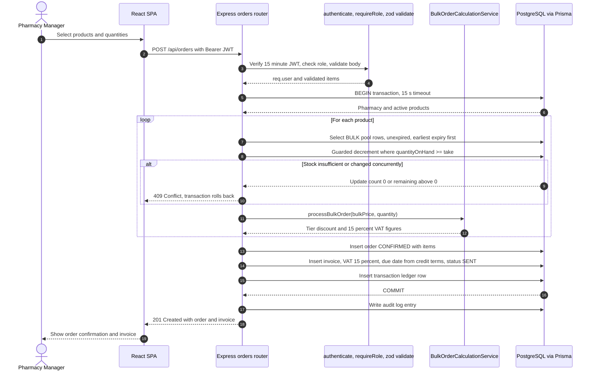
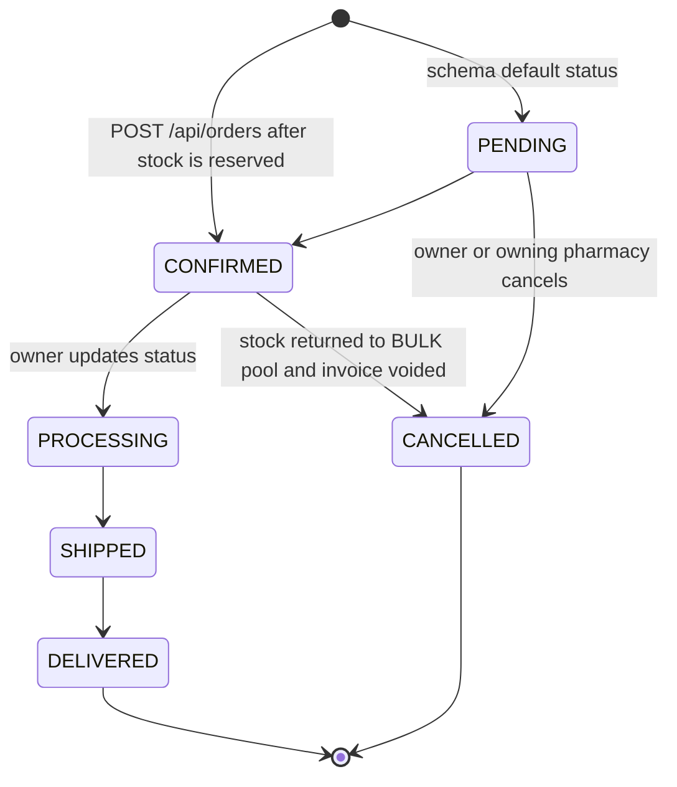
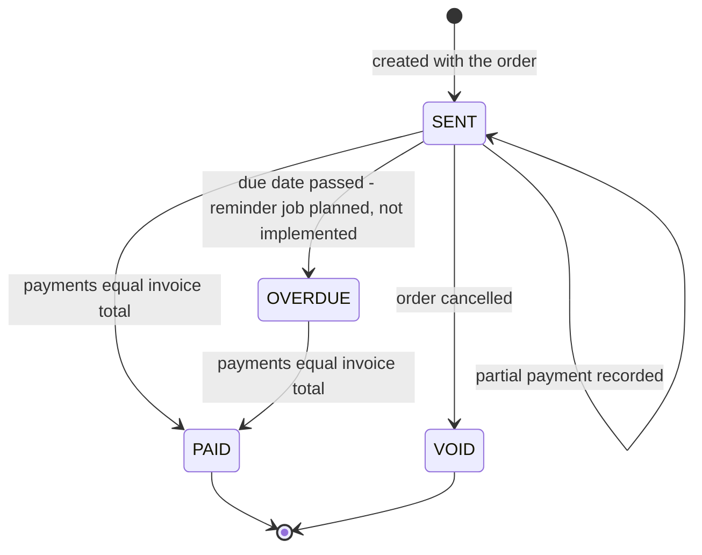
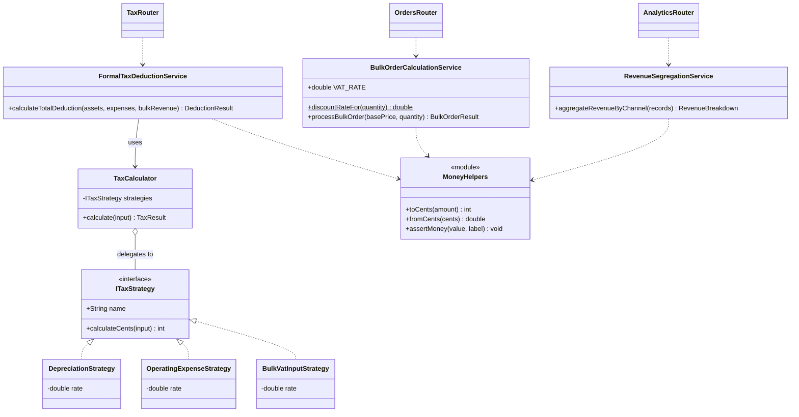

# Production diagrams (generated from the implemented code)

## Place Bulk Order (POST /api/orders)

Difference from the design document: the invoice is created inside the same database transaction as the order (atomic), instead of in a separate decoupled invoice service.

## Order state diagram

Cancellation is only allowed from PENDING or CONFIRMED, and is blocked once a payment exists on the invoice.

## Invoice state diagram

DRAFT exists in the enum but no code path sets it. OVERDUE is reachable only once the planned reminder job is built.

## Design class diagram (service layer)

Rates: depreciation 0.20, operating expenses 0.15, bulk VAT input 0.05. Data entities are defined in backend/prisma/schema.prisma.
