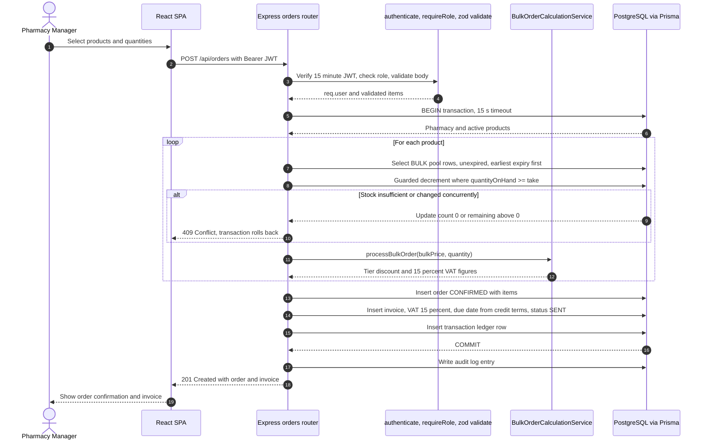

# Production diagrams (generated from the implemented code)

## Place Bulk Order (POST /api/orders)

Difference from the design document: the invoice is created inside the same database transaction as the order (atomic), instead of in a separate decoupled invoice service.
